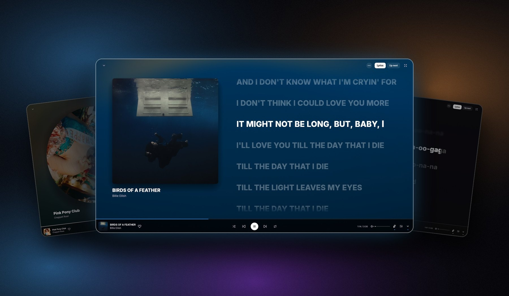
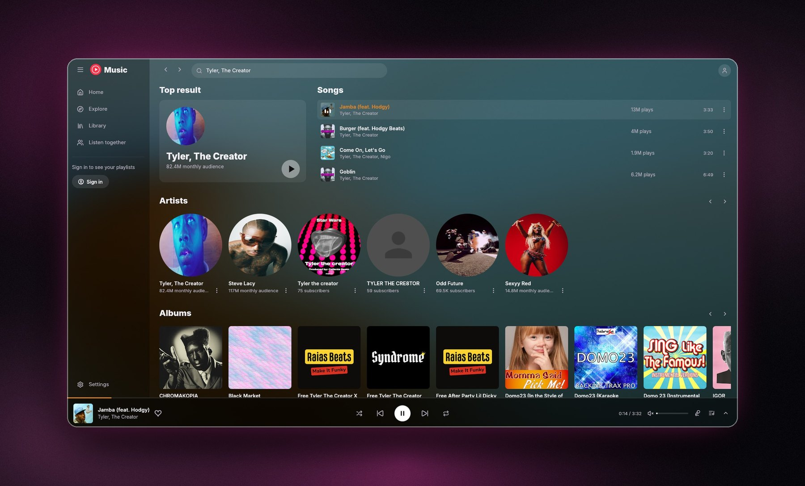

# WhisMuno

**Whis** **Mu**sic **No**tch — a modern YouTube Music desktop player for Windows, macOS, and Linux, featuring a midnight-blue & mint interface, glowing **W** icon, persistent Discord Rich Presence, and a smooth top-docked Dynamic Island lyrics notch.

**[Download Latest Release](https://github.com/whiskyyyyys/BitChord-PC/releases/latest)** · [All Releases](https://github.com/whiskyyyyys/BitChord-PC/releases) · [Actions Builds](https://github.com/whiskyyyyys/BitChord-PC/actions)

## Screenshots

<p align="center">
  
</p>

| Home & Library | Search & Browse |
| :---: | :---: |
|  |  |

| Themes & Customization | Artist View |
| :---: | :---: |
|  |  |

## Features

- **Dynamic Island Lyrics Notch** — open **Settings → Notch** to enable the top-docked OLED Dynamic Island bar.
  - **Compact mode**: mini album cover, auto-width centered lyrics with smooth rising & word-synced highlight, 4-bar animated equalizer, and a quick **Tuck (`⌃`)** button to hide into a slim top-edge pill.
  - **Expanded mode** (click the notch): album artwork, track & artist info, synced lyric line, seekable progress bar, **Previous / Play-Pause / Next** controls, volume slider, Tuck (`⌃`), Collapse (`−`), and Turn off (`×`).
- **Music and lyrics** — browse your library, play tracks, and follow word/line-synced lyrics when available.
- **Discord Rich Presence** — displays *"Listening to WhisMuno"* with the current song and artist on your profile (including paused status when playback pauses) and recovers automatically if Discord restarts.
- **Portable & Installer builds** — available as Windows `.exe` installer, Windows `.zip` portable, macOS `.dmg`, and Linux `.tar.gz`.

## Getting started

Download the build for your OS from **[Releases](https://github.com/whiskyyyyys/BitChord-PC/releases/latest)**:

- **Windows (Installer)**: download and run `WhisMuno-2.0.4-Windows-x64-Setup.exe`.
- **Windows (Portable)**: download `WhisMuno-2.0.4-Windows-x64-Portable.zip`, extract all files into one folder, and run `bitchord.exe`.
- **macOS**: open `WhisMuno-2.0.4-macOS.dmg` and drag `bitchord.app` to **Applications** (first launch: right-click → **Open**).
- **Linux x64**: extract `WhisMuno-2.0.4-Linux-x64.tar.gz` and run `./install.sh` (or run `./bitchord` directly).

For Discord Rich Presence, open Discord desktop, enable activity sharing in Discord, then turn on **Settings → Connections → Discord** in WhisMuno.

## Build from source

Requirements on Windows: **Rust stable** and **MSVC Build Tools**.

```powershell
cargo build --locked --release
```

Every push to `main` triggers `.github/workflows/custom-windows.yml`, which compiles WhisMuno for Windows, macOS, and Linux and publishes all packages to **GitHub Releases**.

Based on [BitChord PC](https://github.com/jackychan4891/BitChord-PC-Official) under [GPL-3.0-only](LICENSE). WhisMuno modifications are distributed under the same license.
